# Kalkan

**Triage security reports in minutes, not hours.** Kalkan checks every claim in
a vulnerability report against your code and drafts a polite reply. Bring your
own AI, or none.


**Status: early development (v0.1).** Kalkan only suggests. It never closes,
sends or publishes anything; you make the final call.

## How it works

```mermaid
flowchart LR
    R[Report + repo<br/>runs locally] --> S[Reader<br/>flags hidden instructions]
    S --> C[Checker<br/>verifies files, functions, lines]
    C --> X[Code context<br/>our code picks the code]
    X --> A[Analyst agent<br/>compares claims with code]
    A --> K[Skeptic agent<br/>tries to refute the analysis]
    K --> V[Verdict rules<br/>disagreement goes to a human]
    V --> W[Writer agent<br/>summary + polite reply]
    W --> M[Maintainer<br/>makes the final call]
```



1. **Reader** loads the report (Markdown, text or GitHub advisory JSON),
   removes invisible characters and flags hidden HTML, base64 blobs and
   prompt-injection attempts.
2. **Checker** (no AI) extracts claims (files, functions, line numbers,
   versions, commits, code snippets) and verifies each one with `git`. Made-up
   functions and line 9999 of a 2,000-line file are caught here.
3. **Code context**: Kalkan's code, not the AI, picks the relevant code,
   read at the version the report names.
4. **Analyst** and **skeptic** agents judge the report from the code; the
   skeptic argues against the analyst in both directions.
5. **Verdict rules** combine everything: `likely_valid`, `needs_evidence`,
   `likely_invalid` or `needs_human`. When in doubt, a human decides.
6. **Writer** drafts a short summary for you and a polite reply asking for
   exactly the missing evidence.

With `--no-ai`, steps 1–3 run alone and the summary and reply come from
templates.

## Quickstart

With a free local model through [Ollama](https://ollama.com):

```bash
uv tool install kalkan
ollama pull qwen2.5-coder:7b
KALKAN_MODEL=ollama:qwen2.5-coder:7b kalkan triage report.md --repo path/to/your/project
```

Other providers (your own key; Kalkan has no server):

```bash
ANTHROPIC_API_KEY=... kalkan triage report.md --repo . --model anthropic:claude-opus-5-5
OPENAI_API_KEY=... kalkan triage report.md --repo . --model openai:<model-id>
KALKAN_BASE_URL=https://openrouter.ai/api/v1 KALKAN_API_KEY=... kalkan triage report.md --repo . --model compat:<model-id>
kalkan triage report.md --repo . --no-ai   # deterministic checks only
```

`kalkan doctor` shows which provider is configured and checks that it answers.

### Commands

| Command | What it does |
| --- | --- |
| `kalkan triage <report> --repo <path>` | Full triage. `--format md\|json`, `--out <file>`, `--max-tokens`, `--no-ai`. Exit codes: 0 done, 2 bad input, 3 provider error (partial output still written). |
| `kalkan triage-dir <folder> --repo <path>` | Every report in a folder, one result each plus `index.md`. |
| `kalkan fetch --repo owner/name --out reports/` | Download private vulnerability reports from GitHub (needs `gh auth login` or `GH_TOKEN`). |
| `kalkan check <report> --repo <path>` | Claim table and quality signals only (no AI). |
| `kalkan inspect <report>` | Sanitizer notes and detected injection phrases. |
| `kalkan context <report> --repo <path>` | The code the agents would see. |
| `kalkan doctor` | Provider and model check; prints no secrets. |
| `kalkan schema` | JSON Schema of the JSON output. |

## Results

There are no published accuracy numbers yet. The evaluation runs Kalkan on
reports sent to curl: the public list of invalid AI-generated reports and
curl's own CVEs. The number that matters most is how many **valid** reports
are wrongly called invalid; it must stay close to zero. See
[eval/README.md](eval/README.md) for the method. Results will appear in
`eval/results/` with the date and the model.

## Privacy and safety

- Kalkan runs on your machine. Report content goes nowhere except the LLM
  provider you configure; with Ollama or `--no-ai` it never leaves your machine.
  No telemetry.
- It never closes, sends or publishes anything. It only writes local files.
- Report text is treated as untrusted input: wrapped in `<untrusted_report>`,
  sanitized, and checked for prompt injection. If injection is suspected and an
  agent answers `likely_valid`, the verdict becomes `needs_human`.
- Agents have no tools, no network and no file access.
- Never run Kalkan on private reports in public CI: Actions logs of public
  repositories are visible to everyone.
- See [THREAT_MODEL.md](THREAT_MODEL.md) and [SECURITY.md](SECURITY.md).

## Limitations

- Function detection uses patterns, not a parser; macros and generated code
  can show up as "referenced" or "not found".
- Injection detection is pattern-based; paraphrased or translated instructions
  can slip through (the verdict rules are the second line of defense).
- Small local models are slow (a few minutes per report on a laptop) and less
  accurate than large hosted ones.
- Kalkan does not run proofs of concept (planned for v0.3).

## Roadmap

- **v0.2 Duplicate agent**: is this report a copy of an earlier one?
- **v0.3 Reproducer agent**: run the PoC in an isolated Docker sandbox.
- **v0.4 Patch and advisory agent**: draft a patch, a regression test and a
  GitHub advisory for verified reports (never applied automatically).
- **v0.5 Reporter mode**: reporters check their report before sending and
  attach a proof bundle maintainers can verify with one command.

## Contributing

Contributions are welcome. See [CONTRIBUTING.md](CONTRIBUTING.md) and the
[good first issues](docs/first-issues.md). Please follow the
[Code of Conduct](CODE_OF_CONDUCT.md).

## License

Apache-2.0
